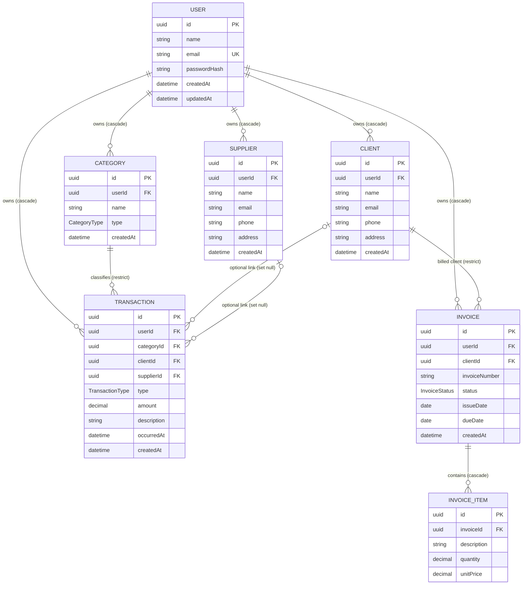

# ProfitX — Entity Relationship Diagram

## Enums

- `TransactionType`: `INCOME`, `EXPENSE`.
- `CategoryType`: `INCOME`, `EXPENSE`.
- `InvoiceStatus`: `DRAFT`, `SENT`, `PAID`, `OVERDUE`, `CANCELLED`.

## Transaction fields and relationships

- `type` is required and uses `TransactionType` (`INCOME` or `EXPENSE`).
- `amount` is required and stored as `Decimal(12, 2)`.
- `occurredAt` is required and defaults to the current timestamp; `createdAt` records when the row was created.
- `categoryId` is required and references one category. Deleting a referenced category is restricted.
- `clientId` and `supplierId` are nullable optional references. Deleting the linked client or supplier sets that reference to `NULL`.
- The application-level convention is to associate income with a client and expenses with a supplier. The current schema does not enforce that pairing as a database constraint.

## Other relationships and delete behavior

- `Client`, `Supplier`, `Category`, `Transaction`, and `Invoice` belong to one user. Deleting a user cascades to those owned records.
- An invoice belongs to one client. Deleting a client with invoices is restricted so invoice history remains valid.
- An invoice item belongs to one invoice. Deleting an invoice cascades to its items.
- `passwordHash` stores a password hash, never a plain-text password.
- An invoice item's line total is calculated as `quantity × unitPrice`; it is not stored separately.
- Financial reports should count transactions as income or expenses. An invoice alone is not a recorded payment.

## Indexes in `schema.prisma`

- `User.email` has a unique index for login and duplicate prevention.
- `Client` and `Supplier` have unique compound indexes on `(userId, email)` and regular indexes on `(userId, name)`. These support per-user email checks and user-scoped name listing. Their leading `userId` columns also support user-scoped lookups.
- `Category` has a unique compound index on `(userId, name, type)`.
- `Transaction` has indexes on `(userId, occurredAt)` and `categoryId`.
- `Invoice` has a unique compound index on `(userId, invoiceNumber)` and an index on `(clientId, issueDate)`.
- `InvoiceItem` has an index on `invoiceId`.

The compound indexes beginning with `userId` also serve queries filtering by `userId`; separate single-column indexes would duplicate those index prefixes.
